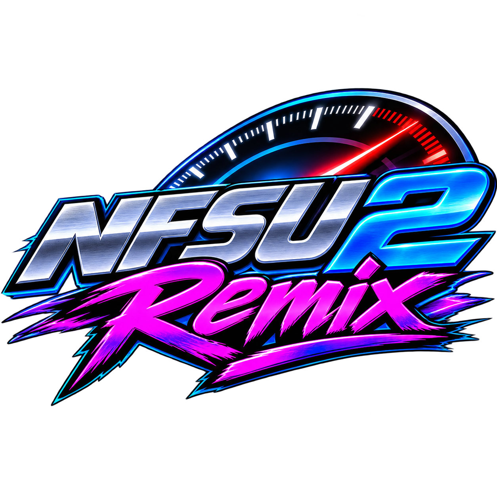

  

# NFSU2 Remix Indonesia

Remix tidak resmi dari port Android **Need for Speed: Underground 2** milik
[codepdbh/nfsu2-recompiled](https://github.com/codepdbh/nfsu2-recompiled) (rekompilasi statis `SPEED2.EXE`
menjadi C, berjalan native di Android dengan DXVK/Vulkan). Remix ini menerjemahkan antarmuka launcher ke
bahasa Indonesia dan menambahkan beberapa penyesuaian kecil.

> **Status:** eksperimental, bukan rilis resmi. Jangan melapor bug remix ini ke developer aslinya.

## Kebutuhan

- HP Android 10 ke atas, arm64, dengan Vulkan 1.1 atau lebih baru.
- **Salinan game Need for Speed: Underground 2 untuk PC milikmu sendiri.** Repo ini tidak berisi file game.

## Pemasangan

1. Pasang APK hasil build (lihat bagian Build). Kalau sebelumnya memakai versi lain dengan tanda tangan
   berbeda, uninstall dulu.
2. Salin isi folder game PC-mu (`SPEED2.EXE`, `GLOBAL`, `TRACKS`, `CARS`, `FRONTEND`, `LANGUAGES`, dst.)
   ke penyimpanan internal di folder `nfsu2`, yaitu `/sdcard/nfsu2/`.
3. Buka **NFSU2 Remix**, izinkan akses file, pilih bahasa, resolusi, dan batas FPS, lalu tekan **MAIN**.

## Kredit dan lisensi

- Proyek asli: [codepdbh/nfsu2-recompiled](https://github.com/codepdbh/nfsu2-recompiled) oleh **codepdbh**,
  dengan dasar [pcrecomp](https://github.com/sp00nznet/pcrecomp) dan DXVK. Seluruh kerja rekompilasi,
  port Android, dan launcher adalah hasil karya mereka.
- Kode tooling dilepas dengan **Lisensi MIT** mengikuti repo asli.
- Need for Speed, Underground, EA, dan semua materi game terkait adalah milik **Electronic Arts Inc.**
  Remix ini tidak berafiliasi dengan EA maupun developer asli, dan tidak menyertakan file game, musik,
  video, atau model 3D milik siapa pun.
